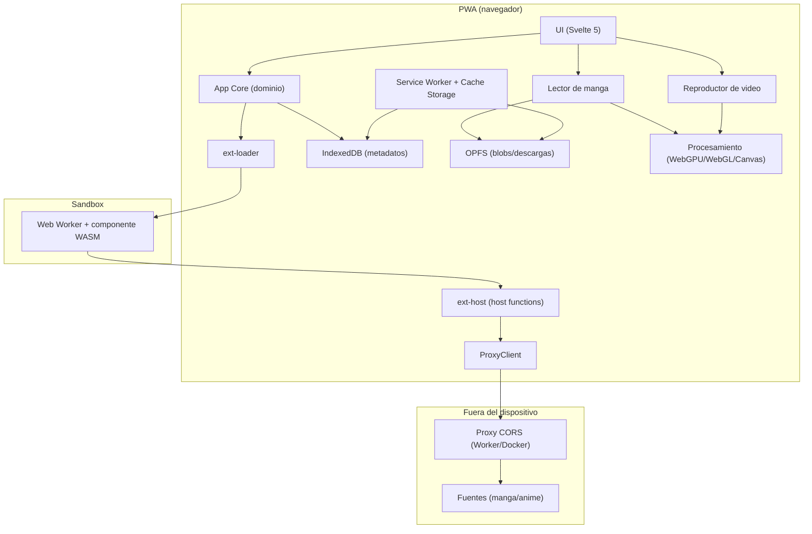
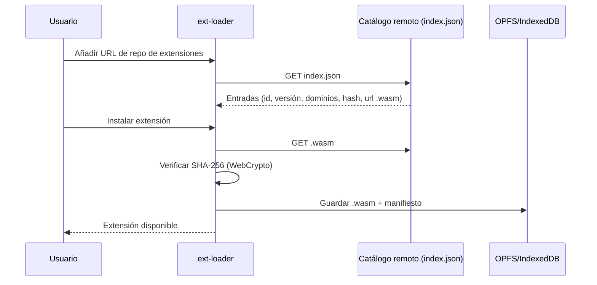
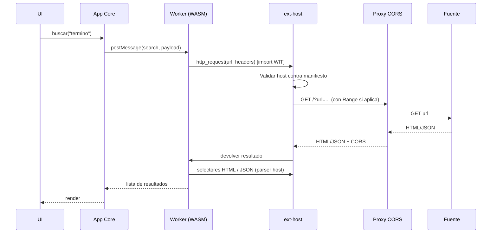

# 02 · Arquitectura

> Fase 2 del roadmap. Define capas, límites de confianza y flujos. Las decisiones concretas (con pros/contras) viven en `docs/adr/`.

## Objetivos de diseño

- 100% cliente: build estático, PWA instalable, sin backend propio.
- Extensiones WASM aisladas: sin DOM, sin red directa, red solo vía host functions.
- Red de extensiones a través de un proxy CORS configurable y del propio usuario.
- Offline-first para manga (descargas a OPFS) y streaming para anime (MSE/HLS/DASH).
- Degradación elegante según plataforma (iOS, sin WebGPU, sin proxy).

## Vista de capas



## Capas y responsabilidades

| Capa | Responsabilidad | No debe |
| --- | --- | --- |
| UI (Svelte 5) | Vistas, interacción, estado de presentación | Contener lógica de red o de extensiones |
| App Core | Modelos de dominio, biblioteca, historial, categorías, ajustes, gestor de descargas, backups | Depender de componentes UI |
| ext-loader | Cargar índices, verificar hashes, instalar/actualizar/quitar extensiones, ciclo de vida de Workers | Ejecutar WASM en el hilo principal |
| ext-host | Implementar `http_request`, parser HTML, JSON, crypto, base64, logging | Dar acceso a DOM, cookies de la app o red directa |
| ProxyClient | Enviar peticiones por el proxy configurado, reintentos, cancelación | Alterar el contenido |
| Lector | Paginado/webtoon/RTL, zoom, precarga, caché a OPFS | Parsear fuentes (eso es de la extensión) |
| Reproductor | MSE + hls.js/dash.js, subtítulos, Media Session, PiP, posición | Depender de una única fuente de video |
| Procesamiento | WebGPU/WebGL/Canvas: reescalado, mejora, OCR/traducción | Ser requisito para funciones núcleo |
| Almacenamiento | IndexedDB (metadatos) y OPFS (blobs) | Guardar video completo en el SW |
| Service Worker | App shell, versiones, actualización | Interceptar/rolar video completo |

## Límites de confianza (trust boundaries)

- **Zona confiable:** UI, App Core y ext-host (código del proyecto).
- **Zona NO confiable:** el componente WASM de la extensión. Corre en un Web Worker aislado; no ve el DOM, ni `fetch`, ni cookies/almacenamiento del origen de la app.
- **Zona externa:** el proxy (propiedad del usuario) y las fuentes de terceros. Contenido tratado siempre como no confiable (sanitizar HTML, validar URLs).
- **Regla de oro:** la extensión solo obtiene aquello que declara su manifiesto (dominios permitidos) y que el host decide conceder. Todo movimiento de red pasa por `http_request`, validado y limitado.

## Flujos principales

### Instalación de una extensión



### Búsqueda / detalle / páginas



### Lectura de capítulo (online y offline)

1. Core pide páginas a la extensión (`getPages(chapter)`).
2. El lector muestra cada página con `` (no requiere CORS).
3. En segundo plano, el gestor de descargas guarda las imágenes en OPFS.
4. Offline: el lector lee de OPFS (blob URL).
5. Mejora visual (opcional): requiere CORS/proxy o la copia local en OPFS.

### Reproducción de episodio

1. Core pide fuentes de video a la extensión (`getVideoSources(episode)`).
2. El reproductor elige calidad/servidor.
3. HLS/DASH vía MSE (hls.js/dash.js) a través del proxy si la fuente no da CORS; HLS nativo en Safari.
4. Subtítulos: WebVTT nativo; ASS vía JASSUB (wasm).
5. Media Session + PiP + recordar posición.

## Estructura de carpetas (borrador)

La versión definitiva se fija en la Fase 5. Borrador alineado con el mapa de la skill:

```
app/
  src/
    routes/            vistas Svelte
    lib/core/          dominio, repositorios, settings, downloads
    lib/storage/       IndexedDB (idb) y OPFS
    lib/reader/        motor del lector
    lib/player/        motor del reproductor
    lib/processing/    pipeline WebGPU/WebGL con fallback
    lib/net/           ProxyClient
    lib/ext/           puente hacia ext-loader/ext-host
    workers/           service worker
  public/              manifest.webmanifest, iconos
packages/
  ext-api/             WIT + tipos TS generados
  ext-host/            host functions
  ext-loader/          carga y verificación de .wasm
crates/
  ext-sdk/             SDK Rust para extensiones
extensions/            extensiones de ejemplo
proxy/                 Worker Cloudflare + Docker
infra/                 Dockerfile, nginx/caddy, compose
docs/                  este directorio
```

## Dependencias previstas (se fijan en fases)

| Área | Candidato | Nota |
| --- | --- | --- |
| Build/UI | Vite + Svelte 5 | ADR-001 |
| PWA | vite-plugin-pwa (injectManifest) | ADR-002 |
| Storage | `idb` | ADR-005 |
| Video | hls.js, dash.js | Fase 9 |
| Subtítulos ASS | JASSUB | Fase 9 |
| Extensión host | `jco` | ADR-003 |
| OCR/ML (opcional) | onnxruntime-web / Transformers.js | ADR-006 |

## Riesgos que condicionan la arquitectura

Ver `docs/01-viabilidad-navegador-pwa.md`: CORS, iOS/Safari, descargas en segundo plano, WebGPU sin soporte en Firefox y cuotas de almacenamiento. Cada uno tiene su mitigación en las decisiones A1–A8 y en los ADRs.
